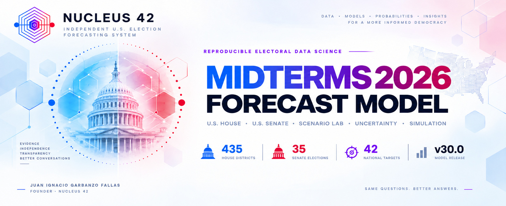
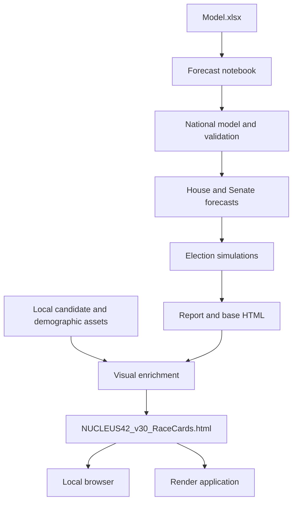
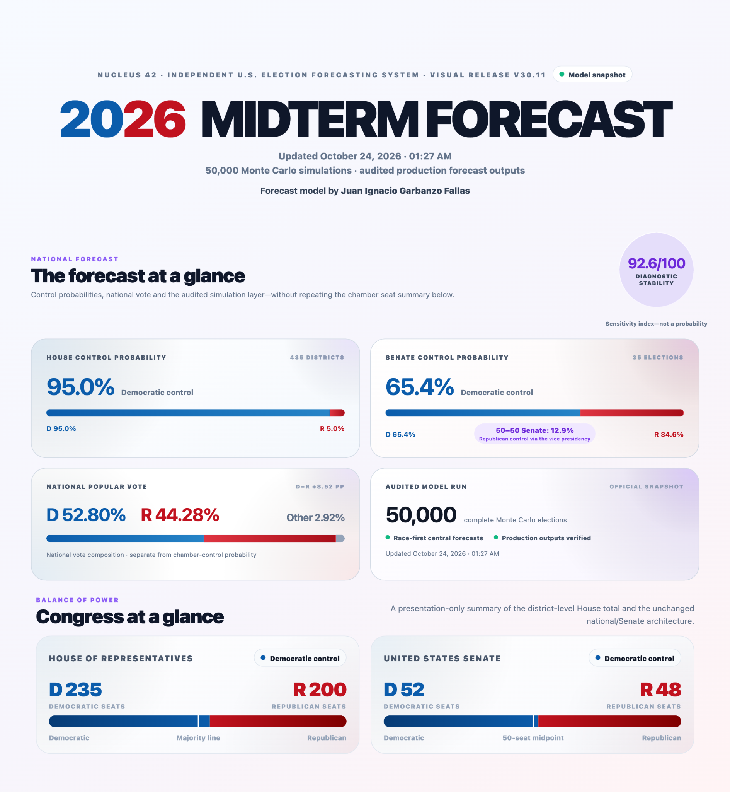
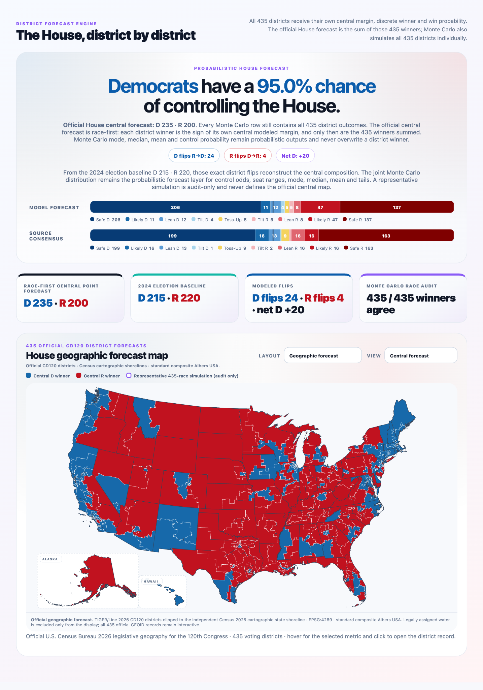
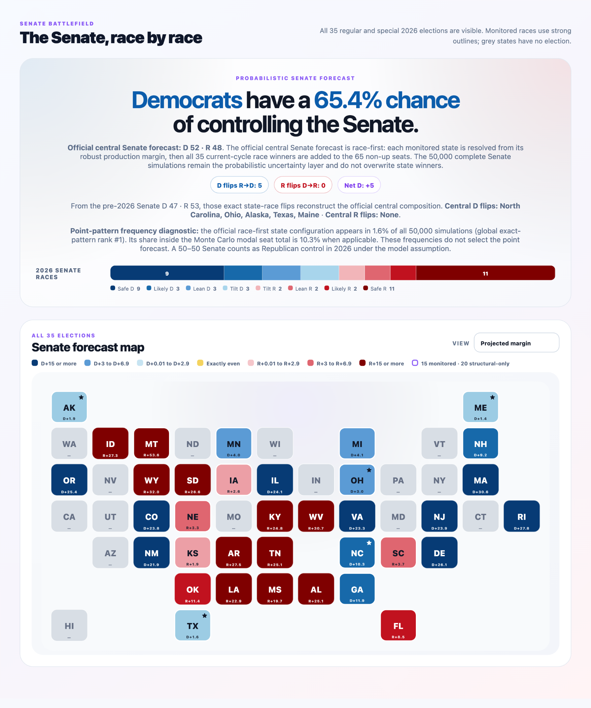
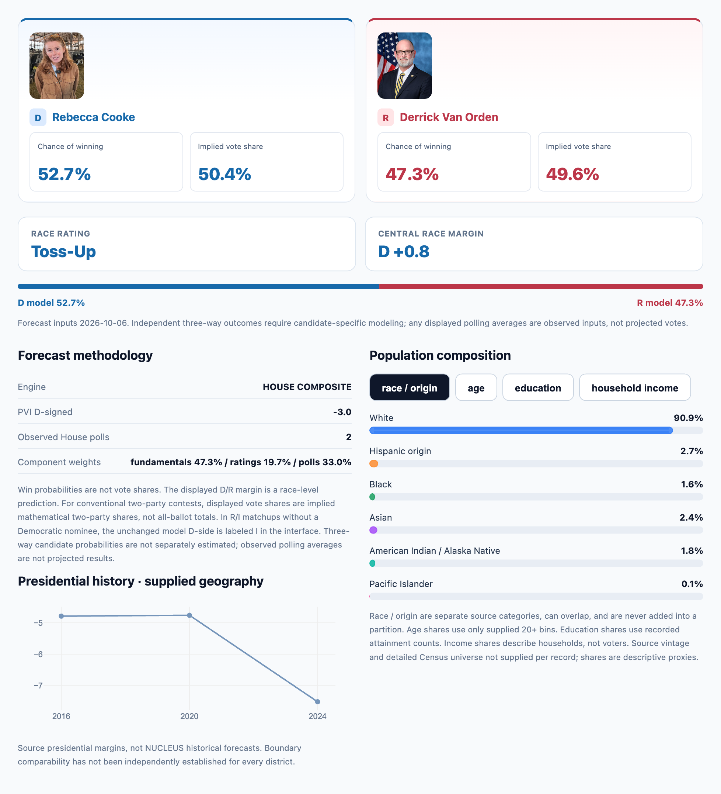
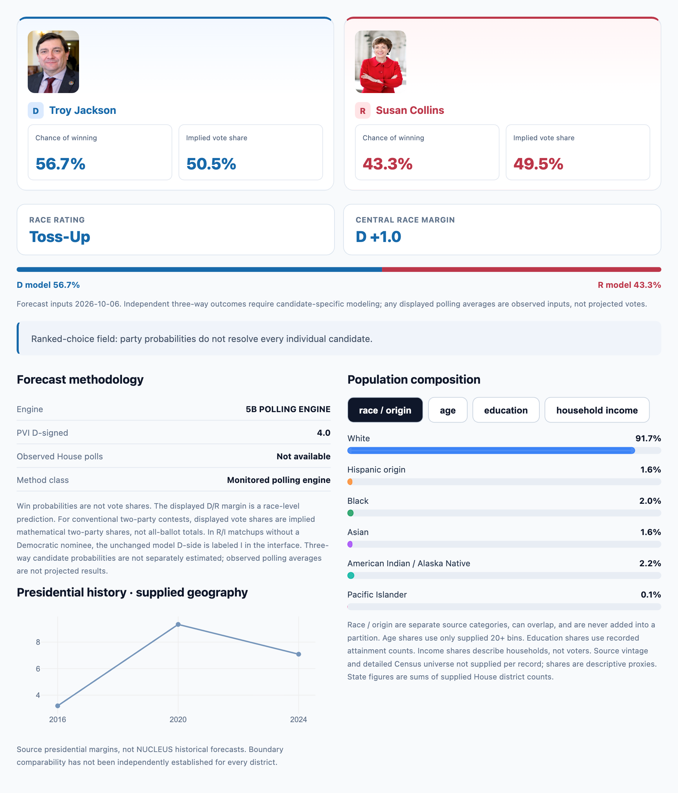
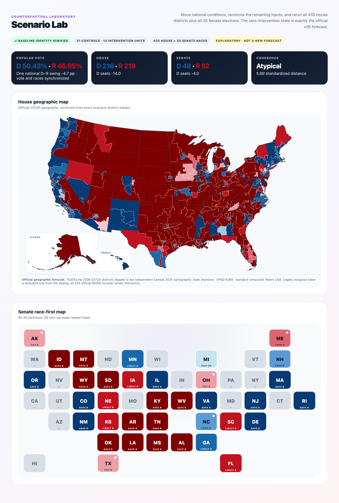
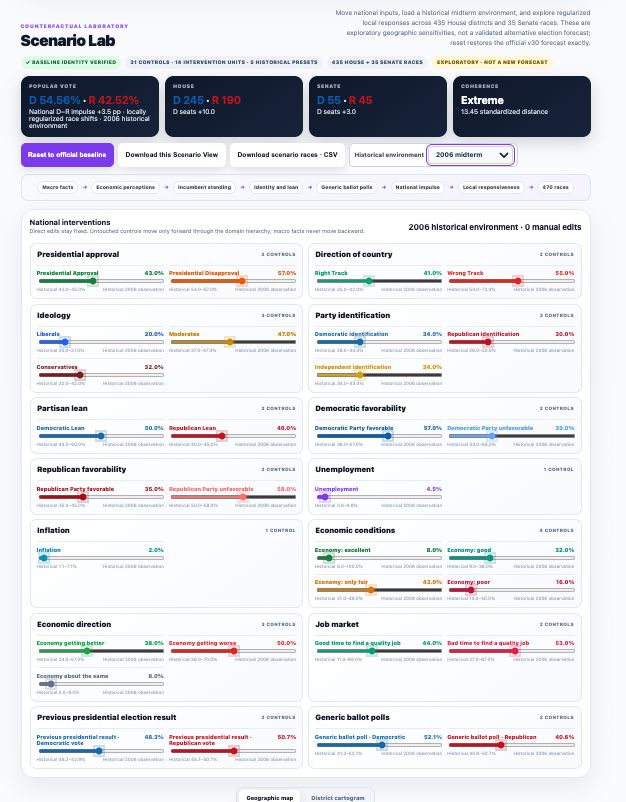

<p align="center">
  
</p>

<p align="center">
  
  
  
  
  
  
  
  
</p>

<h1 align="center">NUCLEUS 42 · 2026 U.S. Midterm Forecast</h1>

<p align="center">
  <strong>An independent election-forecasting project.</strong><br>
  National environment · 435 House districts · 35 Senate elections · uncertainty · historical validation · interactive scenarios
</p>

<p align="center">
  Created by <strong>Juan Ignacio Garbanzo Fallas</strong><br>
  <sub>Independent technical project</sub>
</p>

---

## About the project

NUCLEUS 42 connects a source workbook, a modeling notebook, race-level House and Senate forecasts, historical validation, complete-election Monte Carlo simulations, and a self-contained interactive HTML publication.

The workbook supplies the model inputs. The notebook produces the forecasts, report, and HTML. The web application serves the generated HTML.

Screenshots illustrate particular model runs. Their numbers are examples of executed snapshots, not fixed predictions for subsequent releases.

| Component | Scope |
|---|---|
| National model | 42 targets covering voting intentions, political context, ideology, partisanship, presidential approval, and economic perceptions |
| House forecast | 435 voting districts, with margins, winners, ratings, probabilities, holds, flips, a geographic map, and a cartogram |
| Senate forecast | 35 scheduled elections: **15 monitored polling races + 20 structural-only races** |
| Uncertainty | 50,000 complete simulated elections and chamber-control distributions |
| Scenario Lab | 31 sliders in 14 intervention units; five historical environments; constrained reconciliation and race-specific responses |
| Race Cards | 470 race profiles with candidate identities, portraits, forecast results, presidential history, and demographic context |
| Publication | A self-contained HTML file for local viewing and web hosting |

## Main files

| Resource | Purpose |
|---|---|
| [Forecast notebook](NUCLEUS42_v30.ipynb) | Runs the complete modeling and publication pipeline |
| [Interactive forecast](NUCLEUS42_v30_RaceCards.html) | Generated HTML with forecasts, maps, Race Cards, and Scenario Lab |
| [Input workbook](Model.xlsx) | Canonical source workbook |
| [Consolidated report](outputs/Election_Model_Final_Report_v30.xlsx) | Model outputs, race detail, validation, and audits |
| [Web application](dash_app/) | Serves the generated HTML |
| [Methodology](docs/METHODOLOGY.md) | Model architecture, validation, and uncertainty |
| [Scenario Lab guide](docs/SCENARIO_LAB.md) | Counterfactual assumptions, constraints, and interpretation |
| [Model card](MODEL_CARD.md) | Intended uses and limitations |
| [Publishing guide](docs/PUBLISHING.md) | Publication and release workflow |

> [!IMPORTANT]
> The workbook, executed notebook, report, and HTML should describe the same model run. After updating inputs, run the notebook from beginning to end before publishing the resulting files.

## How the publication works

The notebook generates the report and the HTML publication. The visual enrichment step adds candidate portraits and demographic context to the generated race results.

Render serves `NUCLEUS42_v30_RaceCards.html` from the repository. Generating a new HTML file locally does not update the hosted application until the updated file is committed, pushed, and deployed.



The publication includes Overview, House, Senate, Probability, Simulation, Context, Validation, and Scenario Lab.

- Chamber totals are derived from individual race results.
- Race Cards present the forecast alongside candidate and geographic context.
- Scenario Lab explores changes to national conditions.
- Reset returns Scenario Lab to the official baseline.
- The web server serves the publication without recalculating the model.

## Interface tour

### Forecast overview

<p align="center">
  
</p>

The Overview summarizes chamber-control probabilities, national popular vote, simulation status, and the balance of power.

### House forecast

<p align="center">
  
</p>

The House forecast covers all 435 voting districts. Seat totals are reconstructed from individual district winners.

The interface provides geographic and cartogram views, margins, win probabilities, holds and flips, race filters, and data exports.

### Senate forecast

<p align="center">
  
</p>

The Senate forecast covers **all 35 scheduled elections: 15 monitored races and 20 structural-only races**. The monitored set includes **South Carolina, Florida, and Minnesota**, alongside the previously monitored states. Minnesota is now included in the polling layer as part of the expanded competitive-race coverage.

Each monitored state uses the established polling engine; the other 20 races retain structural estimates. Adding a monitored state updates that race's input coverage. It does not introduce a new forecast method for the other states. Strong outlines identify monitored states on the Senate map.

The chamber balance combines projected winners in these elections with seats that are not up for election.

### Race Cards

The publication includes **435 House Race Cards and 35 Senate Race Cards**.

Each card presents the available information for its race:

- Candidate names, party identities, colors, and portraits.
- Modeled win probabilities.
- Implied two-party vote shares, where applicable.
- Forecast margin and race rating.
- Presidential election history.
- Descriptive demographic context.

Candidate portraits and demographic descriptors are presentation metadata. They do not change the statistical forecast. Missing portrait matches remain explicit rather than being assigned to an uncertain identity.

<table>
<tr>
<td width="50%" align="center"><strong>House example · NY-21</strong></td>
<td width="50%" align="center"><strong>Senate example · Maine</strong></td>
</tr>
<tr>
<td valign="top"></td>
<td valign="top"></td>
</tr>
</table>

Click a district or state on a forecast map to open its Race Card. Map hovers remain available, and cards can be exported as images.

Independent candidate identities are displayed where applicable, including Idaho, Nebraska, and South Dakota. These presentation mappings do not re-estimate the underlying races or create additional candidate-level probabilities.

Local visual resources are maintained under:

- `data/race_assets/`
- `assets/portraits/`
- `nucleus42_visual/`

Block 8 integrates the visual layer through `scripts/enrich_publication.py` and writes `NUCLEUS42_v30_RaceCards.html` to the project root.

Successful visual validation prints `HTML VISUAL VERIFICADO`, together with the race, portrait, and demographic counts. Block 9 checks the final publication for all 470 Race Cards.

The visual resources are bundled locally. Their source documentation is maintained separately from the model's statistical inputs.

### Scenario Lab

<p align="center">
  
</p>

Scenario Lab explores counterfactual changes to national conditions and their consequences for House and Senate races.

It begins at the official forecast baseline. Changes pass through historically scaled relationships and reconciliation constraints before updating race-level results.

Composition controls remain coherent, protected exogenous inputs do not receive reverse feedback, and political and economic effects are interpreted relative to the presidential incumbent party.

#### Sliders and historical environments

**31 sliders, 14 intervention units, five historical presets.** Adjust approval, direction of country, ideology, party identification, partisan lean, party favorability, unemployment, inflation, economic perceptions, job-market perceptions, the previous presidential result, and generic-ballot polling.

| Control | What it does |
|---|---|
| **Historical environment** | Loads the observed starting conditions for **2006, 2010, 2014, 2018, or 2022**, directly from the workbook's historical `Model` rows |
| **Sliders** | Allow manual changes after loading a historical environment; the interface identifies the selected environment and manual edits |
| **Reconciliation** | Keeps composition batteries feasible, respects direct edits, and protects exogenous inputs from reverse feedback |
| **Local race response** | Translates the national two-party impulse into regularized district- and state-specific shifts across 435 House and 35 Senate races |
| **Coherence diagnostic** | Shows how far the constructed environment departs from the observed historical reference |
| **Exports and Reset** | Downloads the scenario view or race CSV; Reset restores the exact official 2026 baseline |

<p align="center">
  
</p>

Selecting **2006**, for example, applies that year's observed national conditions hypothetically to the **2026 races and candidates**. It does not rerun or predict the 2006 election. You can then edit individual sliders to explore a different environment.

Scenario Lab uses the `v30.9-historical-local-response` contract. Approval and direction of country retain their bounded reciprocal bridge; local House and Senate responses are estimated separately and strongly regularized. The race CSV reports the actual shift applied to each race.

These are exploratory sensitivities. Moving a slider does not retrain the forecast, change the input workbook, or recompute official Monte Carlo win probabilities. See the [Scenario Lab guide](docs/SCENARIO_LAB.md) for assumptions and limitations.

> [!NOTE]
> Scenario Lab results are exploratory scenarios. They do not replace the official forecast or update the source workbook.

## Modeling principles

1. **Race first.** Chamber totals follow from race-level outcomes.
2. **No chamber quotas.** The model does not force forecasts toward a desired seat total.
3. **Temporal validation.** Historical election cycles are held out during evaluation.
4. **Distinct probability measures.** Race win probabilities, chamber-control probabilities, point forecasts, and diagnostic stability serve different purposes.
5. **Module isolation.** Presentation metadata cannot rewrite the statistical model.
6. **Traceable fallbacks.** Missing or weak evidence should trigger explicit, auditable behavior.
7. **Consistent publication.** The report and HTML must correspond to the completed model run.

## View the forecast locally

To view the included publication:

1. Download or clone the repository.
2. Open `NUCLEUS42_v30_RaceCards.html` in a modern browser.

No Python installation is required to view the generated HTML. The publication contains its styles, embedded data, maps, Race Cards, Scenario Lab, and export logic.

## Run the web application locally

```bash
python -m venv .venv
source .venv/bin/activate
pip install -r dash_app/requirements.txt
python dash_app/check_setup.py
python dash_app/app.py
```

Open `http://127.0.0.1:8050`.

The web application serves the generated HTML. It does not run the forecasting notebook when a visitor opens the site.

## Reproduce the forecast

Run these commands from the repository root:

```bash
python -m venv .venv
source .venv/bin/activate
pip install -r requirements.txt
jupyter lab NUCLEUS42_v30.ipynb
```

Before executing the notebook:

1. Place the intended input workbook at `Model.xlsx`.
2. Keep the notebook, scripts, and visual resources together in the project folder.
3. Confirm that the notebook's project root points to that folder. On macOS with iCloud Drive, keep the project folder downloaded locally so portrait loading does not wait for cloud downloads.
4. Restart the kernel and select **Run All**.
5. Wait for the final validation block to complete.

The generated publication is:

```text
NUCLEUS42_v30_RaceCards.html
```

The consolidated report is:

```text
outputs/Election_Model_Final_Report_v30.xlsx
```

Check the output paths printed by the notebook. A successful execution should generate the visual publication in the intended project folder and pass the final checks.

Do not publish outputs from an incomplete or failed run.

Additional repository checks:

```bash
python scripts/validate_repository.py
python dash_app/check_setup.py
```

## Repository structure

| Location | Contents |
|---|---|
| `NUCLEUS42_v30.ipynb` | Modeling and publication notebook |
| `NUCLEUS42_v30_RaceCards.html` | Generated interactive publication |
| `Model.xlsx` | Canonical input workbook |
| `outputs/` | Reports, model outputs, and audits |
| `data/race_assets/` | Local candidate and demographic resources |
| `assets/portraits/` | Candidate images |
| `assets/readme/` | README screenshots and banner |
| `assets/branding/` | Branding resources |
| `assets/social/` | Social preview resources |
| `nucleus42_visual/` | Visual enrichment modules |
| `scripts/` | Publication and repository validation scripts |
| `dash_app/` | Web server and deployment checks |
| `docs/` | Methodology and operating documentation |
| `render.yaml` | Render deployment configuration |
| `VERSION` | Release metadata |

## Data and update policy

`Model.xlsx` is the manually maintained canonical workbook for version 30. Existing API/CSV refreshes from the original model remain part of its established workflow.

Workbook changes become a published forecast only after the notebook completes successfully and regenerates the report and HTML.

Candidate identities, portraits, and demographic context are maintained as local presentation resources. Updating these resources does not constitute a new statistical forecast.

The experimental 32-source collector and Block 1A are not part of this release.

[Open the maintained source sheet](https://docs.google.com/spreadsheets/d/1NC80MaJh8vyxrbQsi__HSR2StaSo8mgAJ3iSdilqEj0/edit?usp=sharing)

See [Data Sources](docs/DATA_SOURCES.md) for source roles and refresh rules.

## Interpretation and limitations

- Forecast probabilities express uncertainty; they do not guarantee outcomes.
- Scenario Lab outputs are counterfactual exercises.
- Candidate changes, redistricting, turnout, polling errors, source revisions, and unexpected events can affect outcomes.
- The national popular-vote model is evaluated separately from the race engines. National vote is not mechanically reconstructed from chamber seat totals.
- Diagnostic stability is a sensitivity measure, not a win probability.
- Historical relationships may change.
- Candidate photographs and demographic context may have different reference dates from the forecast inputs.
- Displayed results should be interpreted using the dates and assumptions of the corresponding model run.

## Citation and license

| Resource | Purpose |
|---|---|
| [CITATION.cff](CITATION.cff) | Project citation metadata |
| [MODEL_CARD.md](MODEL_CARD.md) | Intended uses and limitations |
| [CONTRIBUTING.md](CONTRIBUTING.md) | Contribution guidance |
| [SECURITY.md](SECURITY.md) | Security reporting |
| [MIT license](LICENSE) | Repository license terms |

NUCLEUS 42 is an independent technical project by Juan Ignacio Garbanzo Fallas. Institutional references do not imply formal endorsement unless expressly stated.

Third-party data and images retain their applicable source terms. The repository license does not override those terms.
